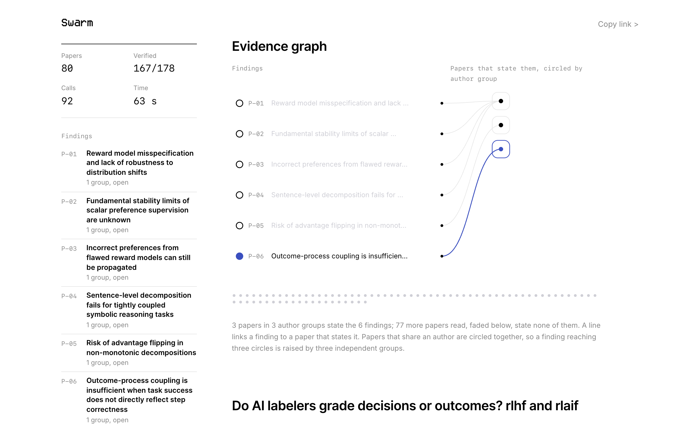

# Swarm

**What's still unsolved in your field?**

  

Say what you'd like to research. Swarm reads every recent paper in that area at once and brings back the problems their authors say are still open: in their own words, explained for you, with what each one needs and where to start.



A real run, the example on the live page: 80 papers read in 63 s, 167 of 178 proposed quotes verified word for word. One of its findings:

```
P-06. Outcome-process coupling is insufficient when task success does not directly reflect step correctness
      1 independent group, 1 paper, needs one GPU

      Tips needs the final outcome to reflect each step's correctness. When success only indirectly depends on
      local steps, the induced process signal gets too weak. Solving this would let outcome-only RL work on tasks
      with sparse or delayed rewards.

      Where to start: Train a small agent on a task with weak outcome-process coupling using the paper "Inducing
      Process Supervision from Outcome-Only Reinforcement Learning" and measure the induced process signal strength.

      In the authors' words, verified verbatim: "Second, Tips relies on sufficient outcome–process coupling: the
      induced process signal is weaker when final task success is only indirectly related to local step
      correctness."   Fan and others, Sep 2026 >
```

## Why

Picking the problem is the hardest part of research, and it's where an advisor helps most: knowing what's open, what's already done, and what you could actually attempt. Many people who want to do research don't have one.

Asking a chat model for ideas gives plausible answers with no way to tell which are real. In a [2025 study](https://arxiv.org/abs/2506.20803), model-generated research ideas rated well on paper and then scored worse than expert ideas once people carried them out. So Swarm doesn't invent problems. It collects the ones experts already wrote down in their papers, and shows you their exact words.

## Run it

You need Python 3.14, Node 24, a [Nebius Token Factory](https://tokenfactory.nebius.com) key and a [Tavily](https://tavily.com) key.

```bash
python3 -m venv .venv && .venv/bin/pip install -r backend/requirements.lock   # backend
npm --prefix frontend install                                                 # frontend
cp .env.example .env                                                          # then add your keys
```

```bash
.venv/bin/uvicorn swarm.app:app --app-dir backend --port 8000 --env-file .env
```

```bash
npm --prefix frontend run dev
```

Open http://localhost:3000. To try it with no keys, no network and no cost, start the backend on the stand-in, which answers with a dozen made-up papers:

```bash
SWARM_STAND_IN=1 .venv/bin/uvicorn swarm.app:app --app-dir backend --port 8000
```

Deploying: [docs/deploy.md](docs/deploy.md).

## Usage

One box. Write what you're curious about in your own words, even if you don't know the field's terms, and if you like, who you are and what you can run on: "Do AI labelers grade decisions or outcomes? I'm a CS student with one GPU."

| You see | Where it comes from | Can you check it? |
|---|---|---|
| "Your question, in the field's words" | The research terms for what you asked, each with a plain meaning | Shown only if the term appears in the papers found |
| "What recent papers say" | 2 to 4 sentences on your question, written by Nemotron Ultra from the most relevant abstracts | Every sentence links the papers it comes from; one citing no paper in the run is dropped |
| "Read these first" | Up to 5 papers, each with why | Each is one of the papers the run found |
| Papers filling in as dots | The newest arXiv papers in your area, up to 80 from the last six months | Each dot is a real paper |
| Open problems, ranked | Sentences where authors say something is unsolved, grouped across papers | The grouping is a model's judgment |
| "Raised by 3 independent groups" | Papers that share no authors | Counted in code from author lists |
| "In the authors' words" | Quotes from each paper | Yes: every quote is checked word for word against its paper |
| "May already be addressed" | A newer paper whose abstract claims to address it, found by a search for that problem alone. These problems move to the end | Its sentence is quoted and checked too |
| Explanation, what it needs, where to start | Written for you by Nemotron Ultra | Read it as a starting point |

Every result has its own link. Copy it from the top of the page.

## Results

### First real run: did it find the right papers?

No. One run on October 28, 2026, one seed, with the input "Do AI labelers grade decisions or outcomes? rlhf and rlaif". Full record in [reports/first-run.json](reports/first-run.json).

| | |
|---|---|
| Papers read | 80, 72 in full and 8 from abstracts |
| Quotes proposed, kept after the word-for-word check | 212, 189 (89%) |
| Open problems found | 6 |
| Time, tokens | 72 s, 77,617 tokens (86 Super calls, 1 Ultra call) |

The reading, quoting and explaining worked. The search didn't: most of the 80 papers were off topic, from astrophysics to a worm's brain, because the searches used single words sorted by newest, which matched thousands of loosely related papers and returned whatever was posted that day. So the six problems were real statements from real papers, but not about the question. I changed the search to exact phrases, within the last six months, sorted by relevance; a manual arXiv query in that form returned papers directly on the question, such as "Inducing Process Supervision from Outcome-Only Reinforcement Learning". It hasn't been run end to end again yet.

### Second real run: right papers, then a failure

Same input, after the search fix. Full record in [reports/second-run.json](reports/second-run.json).

| | |
|---|---|
| Field's terms found | Reinforcement learning from human feedback, process supervision, outcome supervision, reward modeling |
| Searches | "process supervision", "outcome vs process supervision", "reward model" |
| Papers read | 80, 79 in full, all on reward models and process or outcome supervision |
| Statements kept after the quote check | 175, from 60 papers |
| Result | None: the grouping step failed |

The search worked: papers such as "Inducing Process Supervision from Outcome-Only Reinforcement Learning" and "Reconciling Process Supervision with Outcome-Based Credit in Agentic Policy Optimization" are directly on the question. Grouping then failed, most likely because the reply ran past its 2,000-token limit, and the code hid the error. I raised the limit to 6,000, capped the groups at 10, and made a failed grouping say so plainly. Not yet run again.

### Third and fourth real runs: two more failures, both fixed

| Run | What happened | Fix |
|---|---|---|
| Third ([record](reports/third-run.json)) | Stopped in 3 s: every search required all of its phrases and found nothing | A search that finds nothing tries each phrase alone; the phrases are shown while searching |
| Fourth ([record](reports/fourth-run.json)) | Ran end to end, 80 papers, 220 of 236 quotes kept (93%), 78 s, 110,985 tokens. But grouping made three catch-all categories, one covering 52 papers, out of generic limits like "only tested on one model", and the searches drifted to "constitutional AI" | Extraction skips generic limits; grouping must name one specific problem a project could attack and sees your question; a "problem" with more than 12 statements is dropped as a category; searches use only the terms found |

The fourth run fails the checks below: 3 problems, none specific.

### Fifth real run: passes the original checks, still not good enough

Same input. Full record in [reports/fifth-run.json](reports/fifth-run.json).

| | |
|---|---|
| Field's terms found | RLHF, RLAIF, process supervision, outcome supervision, reward modeling |
| Papers read | 80, 76 in full |
| Quotes kept | 161 of 178 (90%) |
| Open problems | 6, all specific |
| Time, tokens | 67 s, 85,543 tokens |

It passed the five checks set before the first run, which shows they were too weak. Only one problem bears on the question: fine-tuned judges may inherit their base model's preferences on shifted outputs, an unresolved hypothesis in "Scaling Laws for Generative Reward Models". One was the generic "we couldn't test larger models". And one was titled with the question itself while its only quote said something else. The searches also ignored the terms Swarm had just found.

Fixed afterwards: a title must share a meaningful word with its quotes, or it's replaced with the quote's own label; each key term gets its own search; results from all searches merge by relevance; grouping leaves out scale-and-compute limits. Not yet run again.

### Sixth real run: the answer lands, first steps invented titles

Same input, October 29, 2026, through the OpenAlex fallback because arXiv's API wasn't answering. Full record in [reports/sixth-run.json](reports/sixth-run.json).

| | |
|---|---|
| Papers read | 80, 79 in full |
| Quotes kept | 167 of 175 (95%) |
| Open problems | 6; 2 bear directly on the question, 3 are adjacent, 1 is a generic scale limit |
| Time, tokens | 49 s, 133,263 tokens (94 Super calls, 2 Ultra calls) |

The new answer section addressed the question directly: recent work contrasts outcome supervision (grading the final answer) with process supervision (grading each step), and RLAIF itself doesn't appear in the abstracts. The best problems were step-level versus sequence-level reward models, and LLM judges that catch some kinds of bias but not others. Two faults: every first step named its paper by a title that doesn't exist, and three explanations spelled out abbreviations wrongly.

Fixed afterwards: the explainer sees each problem's real paper titles; a quoted title that isn't one of them is replaced in code with the closest real one; a spelled-out abbreviation stays only if the papers contain it; scale and compute limits are dropped in code before grouping. Not yet run again.

### Seventh real run: the fixes hold, saved as the example

Same input, October 29, 2026, through the OpenAlex fallback. Full record in [reports/seventh-run.json](reports/seventh-run.json); it's the example on the home page.

| | |
|---|---|
| Papers read | 80, 78 in full |
| Quotes kept | 167 of 178 (94%) |
| Open problems | 6, all on reward models and process versus outcome supervision |
| First steps naming a real paper by its exact title | 6 of 6 (0 of 6 in the sixth run) |
| Time, tokens | 63 s, 128,218 tokens (90 Super calls, 2 Ultra calls) |

The answer addressed the question directly, including RLAIF work on debate-trained judges and multi-tier auto-raters. One problem is the question itself: training only on outcomes induces step-level supervision only when outcome and step correctness are tightly coupled. The weakness: four of the six problems come from one paper, each raised by one group, so the list is less diverse than six problems suggests.

### Eighth real run: one paper can't fill the list

Same input, October 29, 2026, with arXiv's API answering again. Full record in [reports/eighth-run.json](reports/eighth-run.json).

| | |
|---|---|
| Papers read | 80, 78 in full |
| Quotes kept | 175 of 193 (91%) |
| Open problems | 4, each from a different paper; 3 bear on the question, 1 doesn't |
| Time, tokens | 44 s, 116,924 tokens (88 Super calls, 2 Ultra calls) |

A problem raised by one group whose papers already back a higher-ranked problem is now skipped. It worked as intended: no paper backs two problems. But the grouping step had few other candidates, so only four problems remained, and one (memory use during long rollouts) is off the question. The seventh run stays the example: all six of its problems bear on the question.

### Ninth real run: a new field, searches too narrow

A new question, October 29, 2026: "I'm a hobbyist with one GPU. What's still hard about teaching a robot arm a new task from just a few demonstrations?" Full record in [reports/ninth-run.json](reports/ninth-run.json).

Nemotron searched only narrow phrases. "Few-shot imitation learning" matches one arXiv paper from the last six months; "imitation learning" matches 80. The run found 3 papers and 2 problems, so it fails the checks below. Now, when the searches find fewer than 30 papers, Swarm also searches the field's everyday name, which Nemotron names in the same call, and adds those papers after the specific ones.

### Tenth real run: the wider search holds

Same question, October 29, 2026. Full record in [reports/tenth-run.json](reports/tenth-run.json).

| | |
|---|---|
| Papers read | 80, 79 in full |
| Quotes kept | 191 of 203 (94%) |
| Open problems | 6, all on the question; every first step names a real paper from the run |
| Time, tokens | 35 s, 128,732 tokens (92 Super calls, 2 Ultra calls) |

The answer names what the papers find hard: errors that compound over long tasks, sharp drops as demonstrations get fewer, new object poses and lighting, and safe exploration on a real robot. The weakness: each problem comes from one group, so none shows independent labs agreeing, and one (generalization to complex real-world settings) is generic.

An outside read of this run found three more faults: no problem showed labs agreeing, a test on a real robot was said to need one GPU, and explanations all ended the same way. Reading its 153 kept quotes showed the agreement was there, for example five papers on tracking or depth failing under occlusion. The grouping prompt had kept it apart: "if lines only share a theme, they are different problems". Two grouping-only calls on the saved quotes, with that rule relaxed, gave groups spanning up to six labs, but most were catch-alls with stray lines, and tightening the wording made them broader. So group membership is now checked, like quotes: one Super call per group that spans papers keeps only the quotes that state the problem, then labs are counted again. A third grouping-only call left one clean two-lab problem (keypoint methods failing under occlusion) and no stray lines.

### Eleventh real run: needs that fit, saved as the second example

Same question, October 29, 2026, with the line check, needs that cover equipment, and the vague-limit filter. Full record in [reports/eleventh-run.json](reports/eleventh-run.json); it's the second example on the home page.

| | |
|---|---|
| Papers read | 80, 79 in full |
| Quotes kept | 193 of 203 (95%) |
| Open problems | 6, all on the question; every first step names a real paper and starts in a simulator or on public data |
| Time, tokens | 39 s, 124,540 tokens (93 Super calls, 2 Ultra calls) |

"Needs one GPU" is now true for every problem, and no vague limit made the list. The weaknesses: the one two-group problem pairs two different claims (vision-language models that can't critique actions, and diagnostics that can't explain grounding failures), the other five come from one group each, and every explanation still ends "Solving this would", despite the prompt.

### Twelfth and thirteenth real runs: a busy field, and a step taken back

A new question, October 29, 2026: "I'm a master's student with one GPU. Why do language models still make things up, and what's still hard about catching it?" Hallucination was picked because many labs work on it, so their limits should overlap. Full records in [reports/twelfth-run.json](reports/twelfth-run.json) and [reports/thirteenth-run.json](reports/thirteenth-run.json).

| | Twelfth | Thirteenth |
|---|---|---|
| Papers read | 80, 75 in full | 80, 74 in full |
| Quotes kept | 232 of 250 (93%) | 186 of 195 (95%) |
| Problems from two or more groups | 0 of 6 | 3 of 6, all boilerplate |
| Time, tokens | 81 s, 135,526 | 73 s, 127,431 |

The twelfth run gave a strong, cited answer, and two first steps linked the papers' own code. But no problem spanned labs, although four labs wrote that factuality is judged by LLM judges for lack of human labels. A recruit step (lines from other papers sharing a word specific to the problem) gave one clean two-lab problem on the saved quotes. In the thirteenth run it merged boilerplate instead: a modest dataset, a fixed prompt. It was removed. The run also searched arXiv for "one GPU" and kept a title about a line the check had dropped; both are fixed, and that boilerplate is filtered. Neither run is an example. Agreement across labs on a specific problem is rarer in limitations sections than boilerplate is, and Swarm now shows it only when every quote supports it.

### Checks for every real run

Set before the first run:

| Check | Pass |
|---|---|
| Problems found | 4 or more |
| Quotes that survive the word-for-word check | Half or more of those proposed |
| Kept quotes that really state an unsolved problem, on a manual read | 80% or more |
| "May already be addressed" without a checked quote | None |
| Explanations a newcomer understands | Judged by a reader outside the field |
| Problems that bear on the question | Half or more, judged by the person who asked (added after the fifth run) |
| Titles that match their quotes | All (added after the fifth run) |

Every run reports papers read, how many in full, quotes proposed and kept, tokens and time, at the bottom of the result.

## How it works

| Step | How |
|---|---|
| Understand you | Nemotron Super translates your words into the field's own terms and 2 or 3 arXiv searches, and notes your level and hardware |
| Find papers | One arXiv request per search, plus one per key term: every phrase must appear, last six months, most relevant first. Results are merged by rank, so each search's best papers make the cut. If arXiv's API doesn't answer, the same search goes to OpenAlex's index of arXiv |
| Read them | Tavily Extract reads each paper's HTML version; Swarm keeps the limitations, future work, discussion and conclusion sections, or the abstract if there are none |
| Extract | Nemotron Super, one call per paper, all at once: every sentence where the authors say something is unsolved, copied exactly |
| Check quotes | A quote is kept only if it's in its paper word for word |
| Group | Nemotron Super groups statements that name the same obstacle, even across papers that word it differently; independence is counted from author lists |
| Check groups | Agreement across labs is the ranking, so it's checked twice: one Super call per group that spans papers names the shared claim and keeps only the quotes that make it, then in code a paper's quotes must share a specific word with the group's main paper (like "occlusion"). Independent groups are then counted again |
| Already addressed? | One more arXiv search per problem, for newer work on exactly that problem. Nemotron Super checks those abstracts and the run's own papers for a claim to address it |
| Answer your question | Alongside the reading, Nemotron Ultra answers your question from the 15 most relevant abstracts and picks what to read first |
| Explain | Nemotron Ultra explains each problem for you, says what it needs and how to start. Paper titles, spelled-out abbreviations and links in the first step are checked against the papers; a paper's code is offered only when the paper itself links it |

**NVIDIA Nemotron on Nebius Token Factory.** Every model call goes through Token Factory's OpenAI-compatible API. Nemotron 3 Super does the fast, parallel work: understanding the question, reading every paper at once, grouping and checking. The account allows Super 1,000 requests a minute, so 80 papers read in parallel instead of one after another. Nemotron 3 Ultra does the two steps that need careful reasoning and writing: the answer and the explanations. The example run made 90 Super calls and 2 Ultra calls in 63 seconds. Tavily Extract supplies the full text the quotes are checked against.

The backend is FastAPI and streams every step as server-sent events. The frontend is Next.js with no UI libraries. Runs are saved to disk, so a shared link keeps working after a restart.

| Path | What's in it |
|---|---|
| `backend/swarm/papers.py` | arXiv search, reading closing sections, independent groups |
| `backend/swarm/problems.py` | Extract, group, check, explain |
| `backend/swarm/verify.py` | The word-for-word quote check |
| `backend/swarm/runs.py` | One run, step by step |
| `backend/swarm/app.py` | The API, caching and limits |
| `backend/swarm/stand_in.py` | The stand-in model and papers for tests |
| `frontend/src/app/page.tsx` | The page |

## Decisions

- **Swarm learns the vocabulary for you.** People new to a field often don't know what it calls their question, and a search in plain words misses the papers that matter. Swarm searches in the field's terms and shows them to you, but only terms that actually appear in the papers it found.
- **Searches are exact phrases, sorted by relevance.** In the first real run, single words sorted by newest returned mostly off-topic papers. "Reward" alone appears in most reinforcement learning papers.
- **Your question is answered first.** In the fifth run, the papers most on the question never appeared on the page; they were only dots. The answer and the papers to read now come before the open problems, and the full list of papers is one click away.
- **Writing rules for every word a model writes.** In the fifth run, all six explanations used the same "This matters because" template and seven em dashes appeared. Every prompt now asks for plain, varied sentences that define their abbreviations, and code turns any em dash into a comma. Quotes are never changed.
- **Math is cleaned before quotes are taken.** arXiv pages print math twice ("the budget kk", "1,0001{,}000"); Swarm collapses those before extraction, so quotes stay word for word and read cleanly. Years and names like "Phase II" are left alone.
- **"Needs" must match the first step.** A first step on a model of 13 billion parameters or fewer can't need a lab.
- **One search looks for surveys,** where a field writes down its own open questions, not one method's caveats.
- **Problems come from papers, not from the model.** Model-generated ideas tend to hold up worse once tried. Authors' own statements of what's unsolved are evidence.
- **Every quote is checked in code.** A quote that isn't in its paper word for word is dropped, ignoring only case, spacing, curly quotes and dashes. The run reports how many were dropped.
- **Agreement means independent groups.** Papers that share an author count once, so one lab repeating itself isn't mistaken for a field agreeing.
- **"May be addressed," never "solved."** A newer paper's claim is quoted so you can judge it.
- **Super reads every paper at once.** This account allows Super 1,000 requests a minute against Nano's 100. 1,000 Super calls finished in 25.7 s with no errors; 1,000 Nano calls hit the limit and took over 5 minutes. Measured with `scripts/speedtest.py`; the raw output wasn't saved, so the numbers come from my notes in `backend/swarm/llm.py`.
- **Thinking is off for the many parallel calls.** It cut one short structured answer from 226 tokens to 53 in a test (same caveat).
- **Ultra only explains.** It's the one step that needs careful writing for a specific reader, and it runs once per result.
- **Each problem gets its own search for newer work.** The run's papers come from one broad search, so a fix published under different keywords would be missed. Problems a newer paper may address move to the end instead of disappearing, with the claim quoted.
- **arXiv requests wait their turn.** arXiv asks for one request every three seconds, so every request on the server is spaced that far apart: 2 or 3 searches plus one per problem, about 30 seconds a run. Full text comes through Tavily so a run doesn't wait minutes for 80 pages.

## Limits

- **Problems are what authors chose to admit.** Limitations sections understate, and some open problems are never written down.
- **arXiv only.** Strong for computer science, machine learning, math and physics; thin elsewhere.
- **Some papers have no readable full text.** Swarm falls back to the abstract and says how many did.
- **Grouping and "may be addressed" are model judgments.** The quotes are there so you can disagree.
- **The newer-work check reads abstracts from arXiv only,** so a fix published elsewhere, or mentioned only in a paper's body, won't be found.
- **Explanations and first steps are written by a model.** Read them as a starting point, not advice.
- **Recent means the last six months,** and at most 80 papers per run.

## Rules

- No test makes a paid call or touches the network. Tests use `backend/swarm/stand_in.py`.
- Every number in this README comes from a file in the repo or says where it came from.
- Paper text and your input are wrapped as data in every prompt, so instructions inside them are ignored.
- A public deploy has a total token budget and a daily one, both kept on disk, plus 3 runs per visitor a day, 6 an hour, and a pause switch; see [docs/deploy.md](docs/deploy.md).

## License

MIT. Fonts are credited in [THIRD_PARTY_NOTICES.md](THIRD_PARTY_NOTICES.md). Paper metadata from arXiv.
